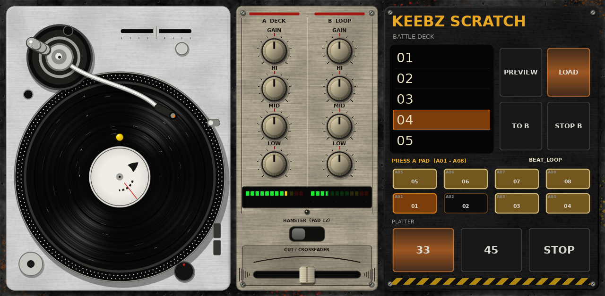
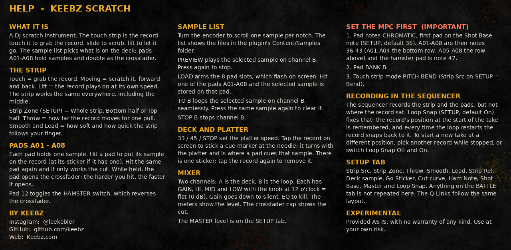
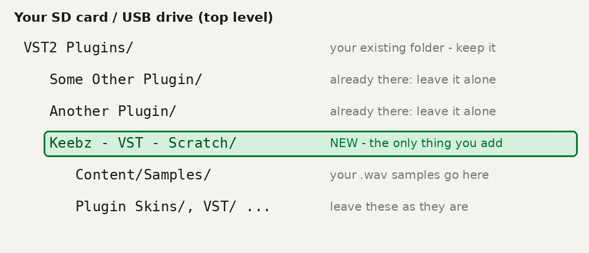
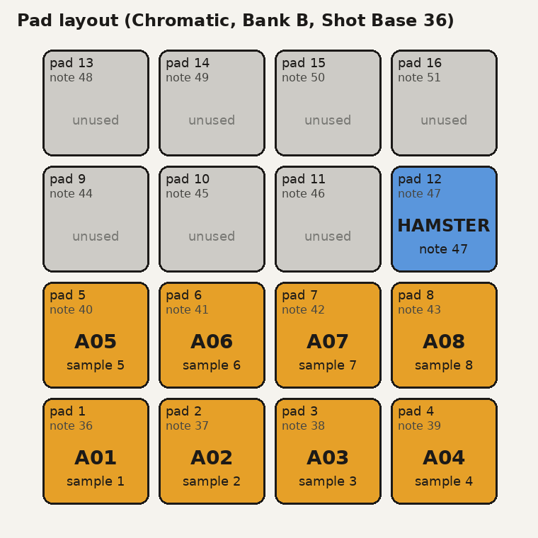
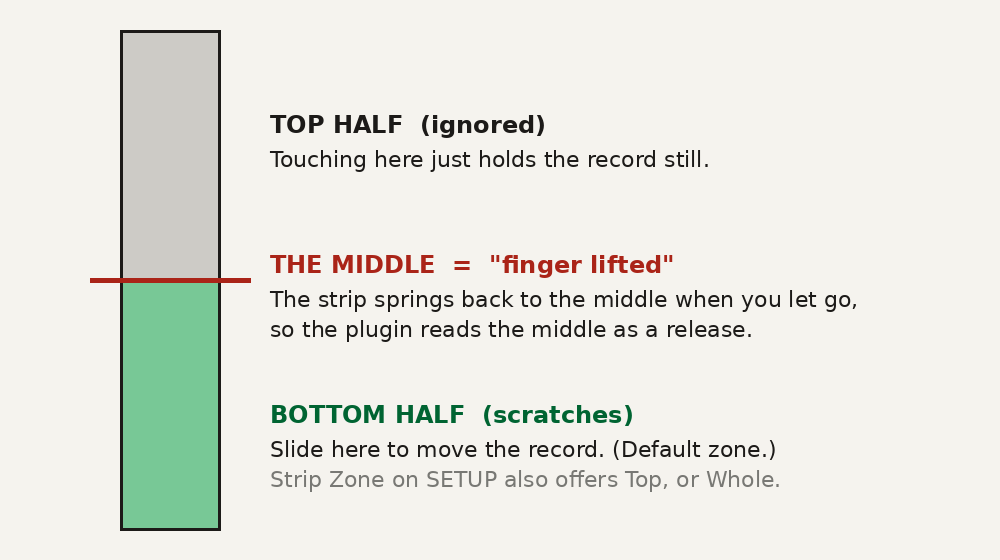

<div align="center">

# KEEBZ SCRATCH

### A DJ scratch instrument for the Akai MPC Live III

**The touch strip is the record.** Grab it, scratch it, let it go.


-1a1612?style=for-the-badge)




<sub>The BATTLE page (design mockup, the MPC uses its own fonts)</sub>

[**Quick Start (PDF)**](docs/Scratch-QuickStart.pdf) &nbsp;·&nbsp; [**Download**](https://github.com/keebz/Scratch/releases) &nbsp;·&nbsp; [Install](#install) &nbsp;·&nbsp; [MPC setup](#set-up-the-mpc-this-matters) &nbsp;·&nbsp; [Credits](#credits)

</div>

> [!WARNING]
> **Experimental software, provided "AS IS", with no warranty of any kind.** Use it at your own risk and back up your projects and your card first. External plugin support on the MPC is itself a beta feature. See the [disclaimer](#disclaimer).

---

## Contents

- [What it is](#what-it-is)
- [Install](#install)
- [Set up the MPC (this matters)](#set-up-the-mpc-this-matters)
- [Playing it](#playing-it)
- [Why the touch strip is split in half](#why-the-touch-strip-is-split-in-half)
- [Adding your own samples](#adding-your-own-samples)
- [Recording in the sequencer (Loop Snap)](#recording-in-the-sequencer-loop-snap)
- [SETUP tab reference](#setup-tab-reference)
- [Troubleshooting](#troubleshooting)
- [Building from source](#building-from-source)
- [How it works](#how-it-works)
- [Credits](#credits)
- [Disclaimer](#disclaimer)
- [Author](#author)

## What it is

Scratch turns the MPC Live III into a battle deck. A sample sits on a virtual record, the **touch strip** moves that record like your hand on vinyl, and the **pads** are both the sample slots and the crossfader. Everything you do is recorded by the MPC sequencer like any other instrument.

- **Strip scratching.** Touch to grab, slide to scrub forward and back, lift and the record plays on at its own speed. Tuned on real Live III strip data for low latency and no warble.
- **Eight sample pads (A01-A08).** Hit a pad and its sample goes on the record (at its cue sticker if it has one). While the pad is held the crossfader is open, with a velocity curve.
- **Hamster switch** (pad 12 or on screen) reverses the crossfader.
- **Two channels with DJ EQ.** Channel A is the deck, channel B is a loop deck. Gain, Hi, Mid and Low on the Q-Links, 12 o'clock = flat, EQ kills the band, gain goes to silent.
- **Sample list.** Turn the data encoder to scroll your `Content/Samples` folder, **PREVIEW** a sample, **LOAD** it onto a pad, or send it to channel B with **TO B** and it loops perfectly.
- **On-screen turntable** that spins, moves with your strip and shows your cue sticker.
- **Loop Snap.** The record returns to where it was at the start of your take every time the sequence loops.
- **A built-in HELP tab** and a [Quick Start PDF](docs/Scratch-QuickStart.pdf).

<div align="center">
<br>
<sub>The HELP tab inside the plugin</sub>
</div>

## Install

You need an **MPC Live III on MPC OS 3.10.1 or later** (Preferences → Info), an SD card or USB drive (or the MPC's internal drive in computer mode), and a computer.

1. Download **`Keebz - Scratch v1_0.zip`** from the [Releases page](https://github.com/keebz/Scratch/releases) and unzip it. You get a **`VST2 Plugins`** folder holding one folder, **`Keebz - VST - Scratch`**, and the Quick Start PDF.
2. Put the plugin on the drive:
   - **No `VST2 Plugins` folder on the drive yet:** copy the whole `VST2 Plugins` folder to the **top level** of the drive.
   - **You already have a `VST2 Plugins` folder with other plugins:** open it and copy **only** the `Keebz - VST - Scratch` folder into it.

   > [!CAUTION]
   > **Do not replace your existing `VST2 Plugins` folder.** If your computer asks whether to *Replace* a folder with the same name, choose **Stop / Cancel**. On a Mac, Replace deletes what was in your folder (your other plugins). Add only the Scratch folder.

   <div align="center"></div>

3. Eject the drive safely and put it in the MPC.
4. On the MPC open **Preferences → Enhancements (Beta)** and turn on **Enable Enhancements** and **External Plugin Support**. Read the warning. The plugin stays hidden until both are on.
5. Create a plugin track or program and pick **Scratch (Keebz)** from the plugin list. Menu wording can differ a little between MPC OS versions.

**Updating:** copy your own samples out of `Content/Samples`, delete the old `Keebz - VST - Scratch` folder, copy the new one in and put your samples back. Projects keep working because the plugin's identity never changes.

## Set up the MPC (this matters)

Three things must be set on the MPC or the pads and strip will not behave as described:

| # | Setting | Why |
|---|---|---|
| 1 | **Notes = Chromatic** | The 16 pads must send consecutive notes. Pad 1 sends note **36** (the plugin's *Shot Base*, default 36) so pads 1-8 are the sample pads **A01-A08** and pad 12 (note 47) is the hamster switch. |
| 2 | **Touch strip = Pitch Bend** | The plugin scratches with the strip's pitch-bend messages. On the SETUP tab *Strip Src* must read **Bend**. |
| 3 | **Pad bank = B** | The pad layout is built for Bank B. |

<div align="center"></div>

## Playing it

| Control | What it does |
|---|---|
| **Touch strip** | Touch = grab the record. Slide = scratch. Lift = it plays on. |
| **Pads A01-A08** | Put that pad's sample on the record. Held = crossfader open (velocity curve). Same pad again = only the cut. |
| **Pad 12 / HAMSTER** | Reverses the crossfader. |
| **Encoder / list** | Scroll the samples, one line per notch. |
| **PREVIEW** | Plays the selected sample on channel B. |
| **LOAD** | Arms the 8 pad slots (they flash). Hit a pad A01-A08 to store the selected sample on it. |
| **TO B / STOP B** | Loop the selected sample on channel B, seamlessly / stop it. |
| **Tap the record** | Sticks a cue marker at the needle (one sticker, tap again to remove). Pads cue the record there. |
| **33 / 45 / STOP** | Platter speed. |
| **Q-Links** | Channel A and B: Gain, Hi, Mid, Low. |

The platter turns once per 1.8 s of record travel and *Throw* is measured in seconds of audio, so the feel is the same for a short chop and a long loop.

## Why the touch strip is split in half

The MPC's touch strip is really a **pitch wheel**. A pitch wheel springs back to the middle, so when you lift your finger the MPC sends "middle", which is exactly the same message as touching the exact middle. The plugin cannot tell *finger resting in the middle* from *finger lifted*, so a record scratched across the middle would hang or jump.

The fix: use **half** of the strip. The middle always means "lifted", and the other half is simply ignored (touching it holds the record still). Throw is scaled so the half strip feels as long as a whole one.

<div align="center"></div>

Pick the half in **SETUP → Strip Zone**: **Bottom** (default), **Top**, or **Whole** (the exact middle then acts as a release).

## Adding your own samples

1. On your computer open the drive, then `VST2 Plugins/Keebz - VST - Scratch/Content/Samples`.
2. Copy your `.wav` files in. Delete the ones you do not want.
3. Put the drive back in the MPC and reload the plugin (or the project). The new files appear in the list.

- **Files:** WAV, mono or stereo, 8 to 32-bit, any sample rate. Up to **32** files are used, each up to **6 seconds** (longer files are cut).
- **Order:** by file name. Start names with numbers to set the order (`01 Kick.wav`, `02 Snare.wav`). The leading number is not shown; names appear in capitals, up to 9 characters.
- **Pads point at list positions** (A01 = 1st file, A02 = 2nd, ...) until you change them with LOAD. If you add or remove files, check which sample sits on which pad.
- **`Beat_Loop.wav`** is a loop meant for channel B: select it and press **TO B**. Replace it with your own loop if you like.

## Recording in the sequencer (Loop Snap)

The MPC sequencer records your strip and pad moves, but not *where the record was sitting*. Without help, each loop pass would start the sample somewhere else.

With **Loop Snap** (SETUP, on by default) the plugin remembers the record's position, platter turn, sample and speed when the take starts, and puts them back whenever the song position reaches that point again (loop wrap, restart from the same spot). The anchor is saved with the project.

To start a **new take** at a different record position, choose a different sample while stopped, or switch Loop Snap Off and On.

> [!NOTE]
> Loop Snap relies on the song position and play state the MPC gives plugins. If it does not snap on your unit, run the DEBUG build and send the log (see [Troubleshooting](#troubleshooting)).

## SETUP tab reference

| Control | Default | What it does |
|---|---|---|
| **Strip Src** | Bend | How the strip reaches the plugin: Bend (Pitch Bend mode, best), ModWheel or Scrub. |
| **Strip Zone** | Bottom | Which part of the strip scratches: Bottom, Top or Whole. |
| **Throw** | 120 % | How far the record moves for one full strip pull (10-400 %). |
| **Smooth** | 300 | Softens the strip's steps. More = less ripple, a little more delay. |
| **Lead** | 300 | Looks ahead of your finger to cancel that delay (0-300 %). |
| **Strip Rel** | 100 | Release timing for the *Whole* zone. |
| **Deck Sample** | 1 | Which library sample is on the record. |
| **Go Sticker** | 0 | Jump the platter to the sticker. |
| **Cut Curve** | | Crossfader velocity response. |
| **Ham Note** | 47 | MIDI note of the hamster pad. |
| **Shot Base** | 36 | Note of pad 1. Pads A01-A08 are Shot Base + 0..7. |
| **Master** | | Output level. |
| **Loop Snap** | On | See above. |

Controls that are on the BATTLE page (platter speed, hamster, sample list, preview) are not repeated here.

## Troubleshooting

| Problem | Check |
|---|---|
| Plugin not in the list | Both Enhancements switches are on; folder is exactly `Keebz - VST - Scratch` inside a folder exactly `VST2 Plugins` at the top of the drive; MPC OS 3.10.1+. |
| Pads silent or wrong sample | Notes = Chromatic, Bank B, *Shot Base* 36. |
| Strip does nothing, or the record zips on release | Strip mode = Pitch Bend, *Strip Src* = Bend, *Strip Zone* = Bottom. |
| Loop does not snap back | Loop Snap On; try a DEBUG-build log. |
| New samples not showing | Reload the plugin or the project after copying files. |

**Reporting a bug:** use the DEBUG build (`Scratch-bNN-DEBUG-SD-card.zip`, attached to some releases), repeat the problem, and attach the `scratch_log.txt` it writes into the plugin folder.

## Building from source

The plugin is built with the open-source **[MPC Plugin SDK](https://github.com/inmusic-software/mpc-plugin-builder-sdk)**, which this repository does not include. Put this project inside the SDK's `plugins/` folder:

```bash
git clone https://github.com/inmusic-software/mpc-plugin-builder-sdk.git
cd mpc-plugin-builder-sdk
git clone https://github.com/keebz/Scratch.git plugins/Scratch

python3 tools/build.py plugins/Scratch                                   # native + arm32 + arm64 and SDK validation
.sdk-tools/host_sim plugins/Scratch/build/native/scratch.so test --notes 36
```

The SDK's `GETTING_STARTED.md` in the SDK covers toolchain setup. The plugin's own test suite:

```bash
cd plugins/Scratch
g++ -std=c++17 -O1 -w -pthread -I ../../framework -I src tests/scratch_test.cpp -o /tmp/scratch_test && /tmp/scratch_test
```

To rebuild the skin art, the HELP page and the Quick Start PDF and pack numbered zips, run `python3 tools/make_zips.py <build number>` (needs Python with `numpy` for the skin and `Pillow` for text and the PDF).

## How it works

- **Strip tracker** (`src/strip_tracker.h`): a jitter buffer plus a cubic path fitted to the strip's stepped pitch-bend stream, a look-ahead (*Lead*) and a 3-pole smoother (*Smooth*). Tuned on real Live III logs.
- **Lift detection:** in Pitch Bend mode a lift sends one rest value and then nothing, so the plugin uses a zone of the strip where that value can only mean "lifted".
- **Skin:** the touch UI is described in `skins/TUI.json` and generated procedurally by `tools/skin_art.py` and `tools/make_skin.py`; text is baked into the pictures because it is more reliable on the device.
- **Tests:** `tests/scratch_test.cpp` drives the plugin with strip, pad and transport events (ripple, latency, zones, lifts, pads, sample list, channel B loop, Loop Snap) and the SDK's host simulator checks parameters and state round-trips.

More detail and measurements are in [docs/DEVELOPER-NOTES.md](docs/DEVELOPER-NOTES.md) and [docs/scratch-tracking.md](docs/scratch-tracking.md).

## Credits

- **[MPC Plugin SDK](https://github.com/inmusic-software/mpc-plugin-builder-sdk)** by **inMusic Brands, Inc.** (the Akai Professional MPC team), released under the MIT licence. Its plugin framework and tooling are what make external plugins for the MPC possible; Keebz Scratch is compiled against it. Thank you for opening it up. The licence and copyright notice are reproduced in [THIRD_PARTY_NOTICES.md](THIRD_PARTY_NOTICES.md).
- **Akai Professional / inMusic** for the MPC Live III and its external plugin support.
- Everyone who tested builds and sent logs, videos and honest feedback from a real Live III.

"MPC" and "Akai Professional" are trademarks of inMusic Brands, Inc. "VST" is a trademark of Steinberg Media Technologies GmbH, used only to describe the plugin format. Keebz Scratch is an independent project and is not affiliated with or endorsed by any of them.

## Disclaimer

**This software is experimental and comes with no warranties. It is provided "AS IS"**, without warranty of any kind, express or implied, including but not limited to the warranties of merchantability, fitness for a particular purpose and non-infringement. You use it entirely at your own risk. The author is not liable for any damage, data loss or other claim arising from its use.

## License

Source code: [MIT](LICENSE), © 2026 Keebz. The audio files in `Content/Samples` are not covered by that licence. Third-party notices: [THIRD_PARTY_NOTICES.md](THIRD_PARTY_NOTICES.md).

## Author

**Keebz**

[Instagram @leekebler](https://instagram.com/leekebler) · [GitHub keebz](https://github.com/keebz) · [Keebz.com](https://Keebz.com)
